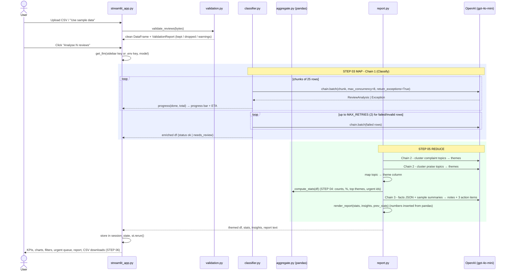

# ReviewLens: Design & Implementation Notes

Notes for developer review. They cover the application flow, the chains, the model settings, error handling, and where to look in the code.
Requirements are in [PRD.md](PRD.md). Setup and deployment are in [README.md](README.md).

---

## 1. At a glance

| Item | Value |
|---|---|
| UI | Streamlit 1.66 (single page, 5 result tabs) |
| LLM framework | LangChain Core 1.8 (LCEL `prompt | model`), `langchain-openai` 1.8 |
| Model | OpenAI **`gpt-4o-mini`** by default (`OPENAI_MODEL`, can be changed in the sidebar) |
| Model settings | `temperature=0`, `timeout=60s`, SDK `max_retries=3` (backoff on 429/5xx/network) |
| Structured output | `with_structured_output(PydanticModel, method="json_schema", strict=True)` |
| LLM chains | **3**: Classify (map), Theme clustering (reduce 1), Weekly insights (reduce 2) |
| Numbers | All counts and percentages are computed in **pandas**. The LLM never produces a statistic |
| Persistence | None. State lives in `st.session_state` for the browser session |
| Packaging | Docker (python:3.12-slim, non-root) + Docker Compose |

---

## 2. Chains

| # | Chain | Built in | Pydantic output | Runs | Invocation |
|---|---|---|---|---|---|
| 1 | **Classify** (map) | `classifier.build_classify_chain` | `ReviewAnalysis` | once **per review** | `chain.batch(chunk, config={"max_concurrency": N}, return_exceptions=True)` |
| 2 | **Theme clustering** (reduce, step 1) | `report.build_theme_chain` | `ThemeClusters` | **up to 2×** per run (complaint topics, praise topics) | `.with_retry(stop_after_attempt=2).invoke()` |
| 3 | **Weekly insights** (reduce, step 2) | `report.build_report_chain` | `WeeklyInsights` | **1×** per run | `.with_retry(stop_after_attempt=2).invoke()` |

All three chains have the same shape:

```python
ChatPromptTemplate.from_messages([("system", SYSTEM), ("human", HUMAN)]) \
    | llm.with_structured_output(Model, method="json_schema", strict=True)
```

There is also one helper call that is not a chain: `llm.check_key()` sends a single `invoke("Reply with ok")` when the user clicks **Test API key**.

### LLM calls per analysis run (N reviews)

```
N                        classify calls (first pass)
+ failed rows × ≤2       automatic retries (MAX_RETRIES=2)
+ ≤2                     theme clustering (complaint + praise; with_retry may double)
+ 1                      weekly insights (with_retry may double)
≈ N + 3 calls            e.g. 250 reviews ≈ 253 calls
```

"Regenerate report text" re-runs **chain 3 only**. Adding or removing last week's file triggers **no** LLM call, because only the numbers are re-rendered.

---

## 3. End-to-end sequence



Text version:

```
Upload ─▶ validate_reviews ─▶ classify_reviews ──(retry ≤2)──▶ assign_themes ─▶ compute_stats ─▶ generate_insights ─▶ render_report ─▶ UI
            (pandas)           [Chain 1 × N]                   [Chain 2 × ≤2]     (pandas)        [Chain 3 × 1]       (pandas numbers)
```

---

## 4. Step-by-step details

### Step 02: Validate (`validation.py`)
1. Read bytes and try encodings `utf-8-sig`, then `cp1252`, then `latin-1`. All columns are read as `str`.
2. Normalise headers: trim, lowercase, spaces become `_` (so `Review Text` becomes `review_text`).
3. Missing required column → `CSVValidationError`, shown as an error and the run stops.
4. Drop completely empty rows, then rows with empty `review_text`.
5. Blank `review_id` gets a generated `AUTO-xxxx`. Duplicate ids are dropped (first one kept).
6. `rating` becomes `Int64` in 1–5. Invalid values become `<NA>` and the row is kept with a warning.
7. `date` is parsed to `YYYY-MM-DD`. Unparseable dates are kept as text with a warning.
8. Rows above `MAX_ROWS` (2000) are cut off.

### Step 03: Classify (`classifier.py`), Chain 1
- **Input variables:** `business_name`, `reply_language_rule` (English / same as review), `review_id`, `platform`, `rating`, `review_text` (cut to 4000 chars).
- **System prompt:** defines the categories, urgency rules (high, medium, low), language detection, and the rules for the English summary, the reply and the topic. It ends with 3 few-shot examples (Tanglish, English, Tamil script).
- **Output `ReviewAnalysis`:** `sentiment`, `category`, `urgency`, `language` (all `Literal` enums), `summary`, `suggested_reply`, `topic`.
- **Validation happens in three layers:**
  1. OpenAI strict JSON schema keeps enum values within the allowed lists while the output is generated.
  2. Pydantic validators (not part of the schema) reject blank text, a summary over 45 words, and a topic over 6 words.
  3. `_is_valid()` re-checks every enum against `config.py` lists.
- **Retry flow:**
  - Any exception or invalid output is recorded in `errors[i]`.
  - Failed rows are re-batched up to `MAX_RETRIES` times, sleeping `min(2*attempt, 5)` seconds before each retry pass.
  - A row that still fails gets `status="needs_review"`, blank analysis fields, and the last error.
  - An `attempts` column records how many tries each row took.
- **Manual retry:** the "Needs review" tab calls `retry_needs_review()`. It re-classifies only those rows, merges them back, and then re-runs the whole reduce step.

### Step 04: Aggregate (`aggregate.py`)
- `ok_rows` means `status == ok`. Every percentage uses this as its base.
- **Complaint** = `negative` OR (`neutral` AND urgency in {medium, high}). **Praise** = `positive`.
- `compute_stats` returns `WeekStats`:
  - totals and the date range
  - sentiment counts and percentages (1 dp)
  - category, urgency and platform counts
  - the list of high-urgency ids and the average rating
  - the top 3 complaint and praise themes, each with its count, dominant platform and share, dominant category, and review ids
- `trend(current, previous)` gives the change versus last week: percentage points for sentiment, plain differences for the counts.

### Step 05: Report (`report.py`), Chains 2 and 3
1. **`assign_themes`:**
   - For complaint rows, then praise rows separately, collect the unique `topic` strings (max 600) and send them to Chain 2.
   - The result is a `{topic: theme}` map. A topic with no theme falls back to `topic.capitalize()`.
   - If Chain 2 fails, the raw topics are used as themes and the run continues.
2. **`compute_stats`** counts reviews per theme in pandas.
3. **`generate_insights`** sends Chain 3:
   - the `_facts()` JSON (all numbers come from pandas)
   - up to 8 sample summaries per top theme
   - up to 25 urgent summaries

   It returns a headline, one short note per theme, and exactly 3 action items. If it fails, `_fallback_insights()` builds the 3 action items from fixed rules, so the report is never lost.
4. **`render_report`** builds the Output-B text block. Every number comes from `WeekStats`. Only the wording (headline, notes, actions) comes from the LLM.

### Step 06: Show + Export (`streamlit_app.py`, `export.py`)
- **Tabs:**
  - **Overview:** sentiment donut, category × sentiment bar, urgency bar, platform × sentiment bar, category trend table.
  - **Reviews:** HIGH-only toggle, multiselect filters, text search, two downloads.
  - **Urgent queue:** an expander per review with the reply in a copyable code block.
  - **Weekly report:** the report text, a `.md` download, and a regenerate button.
  - **Needs review:** the failed rows and a retry button.
- **`to_excel_csv`:**
  - writes UTF-8 **with BOM** so Excel renders Tamil, with CRLF line endings
  - uses a fixed column order (input columns, then the 6 fields, then topic, theme, status, error)
  - prefixes `'` to cells starting with `= + @ \t \r` to block CSV/formula injection
- **`load_enriched`** reads last week's export for the trend comparison and checks its columns.

---

## 5. UI state (`st.session_state`)

| Key | Set when | Holds |
|---|---|---|
| `raw`, `vreport`, `src_sig` | file uploaded / sample clicked | validated input, validation report, sha1 of the file (or `"sample"`) |
| `enriched`, `stats`, `insights`, `report`, `run_secs` | Analyse finished | analysis results |
| `prev_df`, `prev_stats` | last-week file uploaded | comparison data |

- A new file (different `src_sig`) clears all results.
- Filters and tab switches only re-run pandas, never the LLM.
- The API key exists only as a Streamlit widget value in the user's session. It is never stored in files, logs or `session_state` keys.

---

## 6. Module map

```
app/streamlit_app.py      UI orchestration (steps 01–06), sidebar settings, session state
app/reviewlens/
  config.py               env settings (dotenv), allowed value lists, MODEL_CHOICES
  schemas.py              ReviewAnalysis, ThemeClusters/Theme, WeeklyInsights/ThemeNote (+ validators)
  llm.py                  get_llm() factory (the only provider-specific code), check_key()
  validation.py           CSV read + cleaning → (DataFrame, ValidationReport)
  classifier.py           Chain 1, batching, retry, needs_review merge, retry_needs_review()
  aggregate.py            pandas stats, theme stats, trend, arrow()
  report.py               Chain 2, Chain 3, fallback, render_report(), build_weekly_report()
  export.py               Excel-safe CSV, load_enriched()
  ui.py                   presentation only: theme CSS, hero, 6-step stepper, section headers, feature cards, Plotly styling
app/.streamlit/config.toml  light theme (indigo #4f46e5, Inter font), minimal toolbar, 20 MB upload cap
```

**UI notes:**
- Cards are keyed containers (`st.container(key="card_*")`). They are styled through the `st-key-card_*` class that Streamlit adds.
- The stepper is an `st.empty()` placeholder that `show_step(n)` fills: 1 for the landing page, 3 after validation, 7 when the results are shown (all steps done).
- `.env` loading is limited to `ReviewLens/.env` or `app/.env`. A bare `load_dotenv()` searches parent folders and could pick up another project's key.

**Swapping the provider:** change only `llm.get_llm()`, for example to `ChatAnthropic` or `ChatGoogleGenerativeAI`. The chains use only `BaseChatModel.with_structured_output`. If the new provider does not support `method="json_schema", strict=True`, change that argument in the three `build_*_chain` functions.

---

## 7. Error handling summary

| Failure | Handled by | Result |
|---|---|---|
| Bad CSV / missing columns | `CSVValidationError` | Red error message, nothing is sent to the LLM |
| No API key | `MissingAPIKeyError` | Error message, run stopped |
| 429 / 5xx / timeout | OpenAI SDK `max_retries=3` + 60s timeout | Transparent retries |
| Single review fails or is invalid | `return_exceptions=True` + app-level retries | Row marked `needs_review`, batch continues |
| Theme clustering fails | `try/except` in `_cluster` | Raw topics used as themes |
| Report chain fails | `try/except` in `generate_insights` | Rule-based fallback insights |
| Unexpected error during analysis | `try/except` in the UI | Error message, previous results kept |

---

## 8. Configuration (env / `.env`)

| Var | Default | Used by |
|---|---|---|
| `OPENAI_API_KEY` | – | `llm.get_llm` (the sidebar value takes priority) |
| `OPENAI_MODEL` | `gpt-4o-mini` | default model selection |
| `OPENAI_BASE_URL` | – | optional proxy / Azure-compatible endpoint |
| `MAX_CONCURRENCY` | 8 | default of the sidebar slider → `max_concurrency` |
| `MAX_RETRIES` | 2 | classify retry passes |
| `REQUEST_TIMEOUT` | 60 | per-call timeout |
| `CHUNK_SIZE` | 25 | rows per `batch()` (progress granularity) |
| `MAX_ROWS` | 2000 | upload cap |
| `BUSINESS_NAME` | our restaurant | prompts |
| `APP_PORT`, `BIND_ADDR` | 8501, 0.0.0.0 | compose port mapping |

---

## 9. Testing

| File | What it covers |
|---|---|
| `tests/test_pipeline.py` | validation edge cases (BOM, header case, duplicates, empty rows, bad rating) |
| | auto-retry, then `needs_review`, then manual retry |
| | every enum value is in its allowed list |
| | report numbers match the pandas table |
| | last-week trend |
| | Excel BOM, Tamil text and formula escaping in the export |
| | schema rejects an invalid category |
| `tests/test_ui.py` | headless Streamlit `AppTest`: sample data, Analyse, all tabs render, HIGH-only toggle |

- The tests use a **fake LLM** (a `RunnableLambda` returning fixed Pydantic objects). They need no key or network and run in about 10 s with `pytest -q`.
- The real-model chains are only checked to build and to format their prompts. Accuracy for Tamil and Tanglish must be checked manually with a real key.
- For the 200+ row check, `scripts/make_load_test_csv.py 250` creates a load-test file.

---

## 10. Deployment

- `Dockerfile`:
  - python:3.12-slim with pinned `requirements.txt`
  - copies only `app/`; `.dockerignore` excludes `.env`, tests and docs
  - runs as `appuser` (uid 1000)
  - healthcheck on `/_stcore/health`
- `docker-compose.yml`:
  - optional `env_file: .env`
  - port `${BIND_ADDR}:${APP_PORT}:8501`
  - `restart: unless-stopped`, 1 GB memory limit, rotated json logs
- VPS: set `BIND_ADDR=127.0.0.1` and put a reverse proxy with HTTPS (e.g. Caddy) in front. Streamlit needs WebSocket upgrade headers on nginx.

---

## 11. Known limitations and review pointers

- **English summary** is enforced by the prompt only. There is no programmatic language check on `summary`.
- **Theme mapping:** if the LLM puts a topic in two themes, the last one wins. Unknown or misspelled topic echoes fall back to the raw topic.
- **Percentages** are rounded to 1 dp each, so they may not add up to exactly 100.
- **No persistence:** refreshing the browser loses the results. Users should export the CSV. Last week's comparison relies on that export.
- **No auth or rate limiting** in the app, by product decision (D5 in PRD). Every user spends tokens on the configured key.
- **Throughput:** about 250 reviews per run at concurrency 8. Lower the slider if the account's rate limits are low.
- **Prompt text** lives as module constants: `SYSTEM_PROMPT`/`HUMAN_PROMPT` in `classifier.py`, and `THEME_*`/`REPORT_*` in `report.py`.
