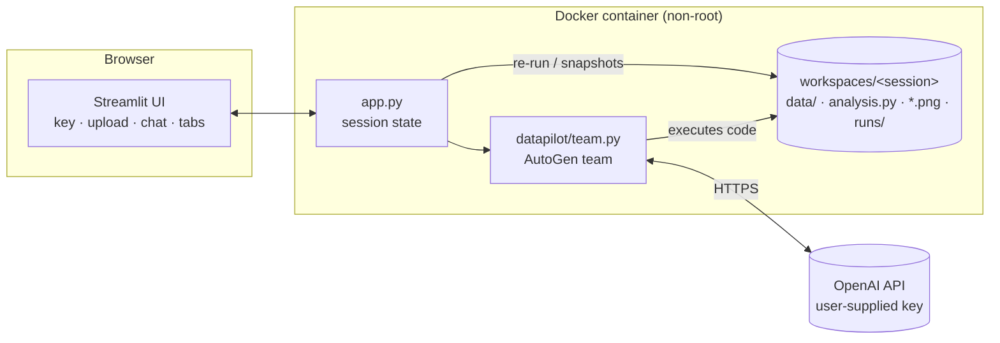
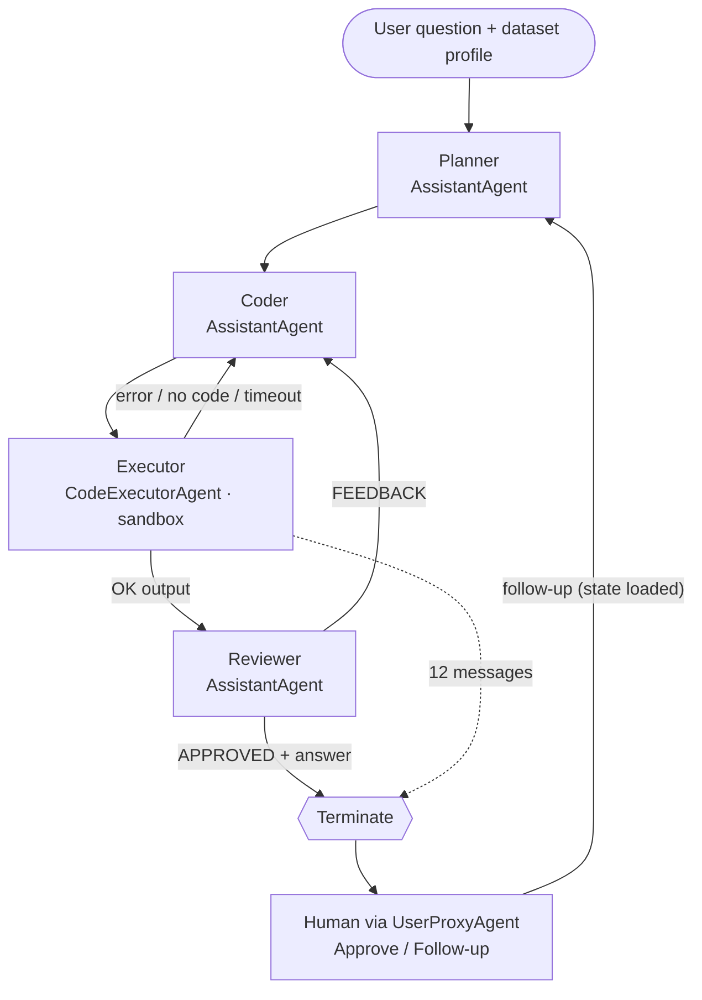
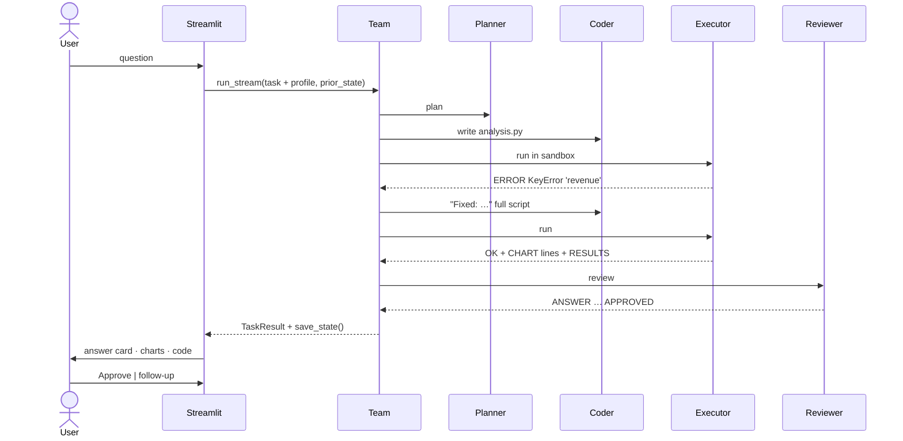

# DataPilot — Design (quick review)

## 1. Architecture



| Module | Responsibility |
|---|---|
| `app.py` | UI, session state, live streaming, human approval, downloads, re-run verification |
| `datapilot/team.py` | Builds agents + team, deterministic routing, termination, run loop, `UserProxyAgent` turn, answer parsing |
| `datapilot/prompts.py` | One system message per agent (single responsibility) |
| `datapilot/workspace.py` | Per-session sandbox folder, dataset profiling, re-run of `analysis.py` |
| `datapilot/report.py` | One-page PDF (answer + charts) |
| `datapilot/ui_theme.py` | Aurora theme CSS, agent badges, pipeline stepper, KPI tiles |

## 2. Agent loop



**Termination** `TextMentionTermination("APPROVED", sources=["Reviewer"]) | MaxMessageTermination(12)` — the
`sources` filter means a Planner/Coder accidentally writing the word cannot end the run.

**Routing** (`SelectorGroupChat`, default) uses a deterministic `selector_func`:

| Last speaker | Next |
|---|---|
| user / User | Planner |
| Planner | Coder |
| Coder | Executor |
| Executor | Coder if output contains *exited with an error* / *Traceback* / *No code blocks found* / *timed out*, else Reviewer |
| Reviewer (not approved) | Coder |
| anything else | `None` → LLM selector fallback |

`RoundRobinGroupChat` is available as the classic option (fixed P→C→E→R order; Planner answers "Plan stands" on re-turns).

## 3. Sequence of one run (with a self-fix)



Every message is streamed to the UI as it arrives (`team.run_stream`).

## 4. Session & state

- Each Streamlit browser session = one `Workspace` (`workspaces/<id>`), one AutoGen team state.
- After each run: `team.save_state()` → `st.session_state.team_state`. Follow-up: new model client + new team,
  `team.load_state(state)` → the agents keep the full conversation (works across Streamlit reruns / event loops).
- Artifacts of each run are snapshotted to `runs/run_N/` (charts + `analysis.py`) so history stays intact.
- Human turn: `UserProxyAgent` with an `input_func` wired to the UI (non-blocking web pattern); its reply becomes the next task.

## 5. Contracts between agents

| Producer | Contract |
|---|---|
| Coder | One ```python block, first line `# filename: analysis.py`, `matplotlib.use("Agg")`, derived columns before use, `CHART \| file \| title \| x \| y` line per chart, `=== RESULTS ===` block, deterministic. |
| Executor | Text output; on non-zero exit prefixed *"The script ran, then exited with an error"* (drives routing). |
| Reviewer | `FEEDBACK:` list **or** `## ANSWER / ## WHERE IT CAME FROM / ## FILES / ## SUGGESTED NEXT QUESTION` + `APPROVED`. Parsed into the answer card. |

## 6. Safety
Container isolation · non-root UID 10001 · code confined to the session folder (executor `work_dir`, filename
must resolve inside it) · 90 s timeout per execution · 2 CPU / 2 GB compose limits · Executor only executes
Coder messages (`sources=["Coder"]`) · API key kept in memory only.

## 7. UI layout

```
┌ Sidebar ───────────────┐ ┌ Hero: DataPilot · Self-Correcting Data Analyst ───────────────────┐
│ ① Connect OpenAI       │ │ [Ask]→[Plan]→[Code ↺2]→[Run]→[Review]→[Answer]   (live stepper)   │
│   key · model · test   │ │ Status | Messages 7/12 | Self-fixes 1 | Review rounds 1           │
│ ② Load data            │ ├ Tabs: 🧠 Conversation | ✅ Answer | 📊 Charts | 🧾 analysis.py | 🗂 Data ┤
│   upload · sample      │ │  agent bubbles with badges (CODE / FIX / ERROR / OK / APPROVED)   │
│ ③ Agent team           │ │  👍 Approve   …or ask a follow-up                                │
│   routing · limit · demo│ └ chat input ──────────────────────────────────────────────────────┘
└────────────────────────┘
```
Theme: deep-space navy with violet/cyan/pink aurora gradients, faint grid, glass panels, Plus Jakarta Sans +
JetBrains Mono, per-agent colours (Planner violet, Coder sky, Executor amber, Reviewer green, You pink).

## 8. Testing
`tests/test_agent_loop.py` uses AutoGen's `ReplayChatCompletionClient` (no key, no cost) to verify: error → fix
loop, APPROVED termination, reproducible `analysis.py`, and follow-up continuing from saved state.
