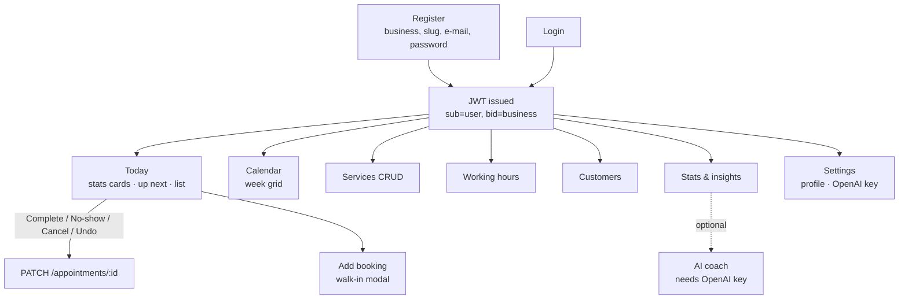

# SlotEase — Design (quick review)

## 1. Architecture

```mermaid
flowchart LR
  subgraph Browser
    C[Customer<br/>/glow-salon]
    O[Owner<br/>/dashboard]
  end
  subgraph Docker Desktop — compose project "slotease"
    N[frontend<br/>nginx :8080<br/>React SPA]
    B[backend<br/>FastAPI :8000<br/>SQLAlchemy]
    D[(db<br/>PostgreSQL 16<br/>volume pgdata)]
  end
  AI[(OpenAI API<br/>optional)]
  C -->|HTTPS| N
  O -->|HTTPS| N
  N -->|/api/* proxy, prefix stripped| B
  B --> D
  B -.->|only if owner supplied key<br/>X-OpenAI-Key header| AI
```

- **frontend**: React 18 with Vite, Tailwind and lucide icons, built into static files and served by nginx. nginx also proxies `/api/*` to the backend, so the browser only ever talks to one origin and no CORS is needed in production.
- **backend**: FastAPI with SQLAlchemy 2. It creates the tables and seeds demo tenants on start, with a Postgres advisory lock so the two workers don't race.
- **db**: Postgres 16 with a health check and a named volume.

## 2. Core flow: customer booking (the 6 steps from the requirement)

```mermaid
sequenceDiagram
  autonumber
  actor Cu as Customer
  participant FE as Booking page
  participant API as FastAPI
  participant DB as PostgreSQL
  Cu->>FE: 01 Open link /glow-salon
  FE->>API: GET /public/glow-salon, /services
  Cu->>FE: pick service + date
  FE->>API: 02 GET /slots?service_id&date
  API->>DB: working_hours + live appointments of that day
  API-->>FE: 03 hours − booked = slots[{start, available}]
  Cu->>FE: 04 choose slot, name, phone → Confirm
  FE->>API: POST /public/glow-salon/bookings
  API->>DB: 05 BEGIN; SELECT business FOR UPDATE
  API->>DB: validate hours/grid/future + overlap check
  API->>DB: upsert customer, INSERT appointment, COMMIT
  alt unique index uq_appointment_slot violated / overlap
    API-->>FE: 409 SLOT_TAKEN
    FE-->>Cu: "Slot just taken" banner + refreshed slots
  else success
    API-->>FE: 201 {booking_id, message, whatsapp_link}
    API-)API: 06 notify (SMTP e-mail or log)
    FE-->>Cu: ✅ Confirmation, WhatsApp, Add-to-calendar
  end
  Note over API,DB: Booking now appears on owner dashboard
```

### Why two concurrent requests can't both win
```
Request A ─┐                         ┌─ commit ✓ (201)
           ├─ SELECT … FOR UPDATE ──►┤
Request B ─┘   (B waits on lock)     └─ sees A's row → overlap → 409
Even if the app check were bypassed: partial UNIQUE (business_id, start_time)
WHERE status <> 'cancelled' → IntegrityError → 409.
```

## 3. Owner flow



Tenant isolation: every owner query runs `WHERE business_id = token.bid`. Another tenant's IDs return 404.

## 4. Screens

| Route | Screen | Key elements |
|---|---|---|
| `/` | Landing | Hero, live dashboard mock, 6-step strip, features, ₹499 pricing |
| `/login`, `/register` | Auth | Glass card, "Use demo account", booking-link preview |
| `/:slug` | Public booking | Business header → 3-step stepper (Service → Date & time → Details) → Confirmation. Sticky bottom bar on mobile |
| `/dashboard` | Today | Date nav, 4 stat cards, month strip, Up-next card, status filters, one-tap actions |
| `/dashboard/calendar` | Week | Time grid, closed-hour shading, status colours, click for details |
| `/dashboard/services` | Services | Cards with toggle, edit modal (duration chips, AI description) |
| `/dashboard/hours` | Hours | Per-day toggle + time pickers, weekly-hours mini chart |
| `/dashboard/customers` | Customers | Searchable table, repeat badges, call/WhatsApp |
| `/dashboard/stats` | Stats | KPI cards, daily bars, status donut, weekday bars, top services, insights, AI coach |
| `/dashboard/settings` | Settings | Business profile, timezone, OpenAI key + model |

## 5. Visual design system

- **Theme**: "Midnight Aurora". The ink-950 (`#060914`) base has animated, blurred violet, fuchsia and teal blobs, a faint grid that fades out and a subtle noise layer. Cards are frosted glass (`bg-ink-900/70`, `border-white/10`, backdrop blur).
- **Contrast**: body text is slate-100 and secondary text slate-300/400, which keeps it legible on the dark glass. Inputs use a solid `ink-800` fill with a visible border, and focus is shown with a violet ring.
- **Colour roles**:
  - Primary actions use a violet→fuchsia gradient.
  - Customer-facing accents are teal.
  - Status colours: Booked = sky, Completed = emerald, No-show = rose, Cancelled = slate. Every status shows a dot and a text label, so it never relies on colour alone.
- **Type**: Sora for headings and numbers; Plus Jakarta Sans for UI text.
- **Motion**: fade-up on cards and a pop animation on confirmation. Disabled under `prefers-reduced-motion`.
- **Mobile**: the booking flow is single-column with a horizontal date strip, a 3-column slot grid and a sticky action bar that respects the safe area. On the dashboard the sidebar becomes a drawer, and the calendar scrolls horizontally.

## 6. Optional LLM

```
Settings → owner pastes sk-… → saved in browser localStorage only
Stats "Get AI advice" → POST /api/ai/insights  (header X-OpenAI-Key)
                       → backend builds prompt from aggregated stats (no names/phones)
                       → OpenAI chat.completions → answer shown
No key → buttons disabled / 400 NO_API_KEY; rule-based insights always shown.
```

## 7. Error contract
`{"error": "SLOT_TAKEN" | "OUTSIDE_HOURS" | "CLOSED" | "INVALID_SLOT" | "PAST_SLOT" | "NOT_FOUND" | "UNAUTHORIZED" | "VALIDATION_ERROR" | "NO_API_KEY" | …, "message": "human-readable"}`
